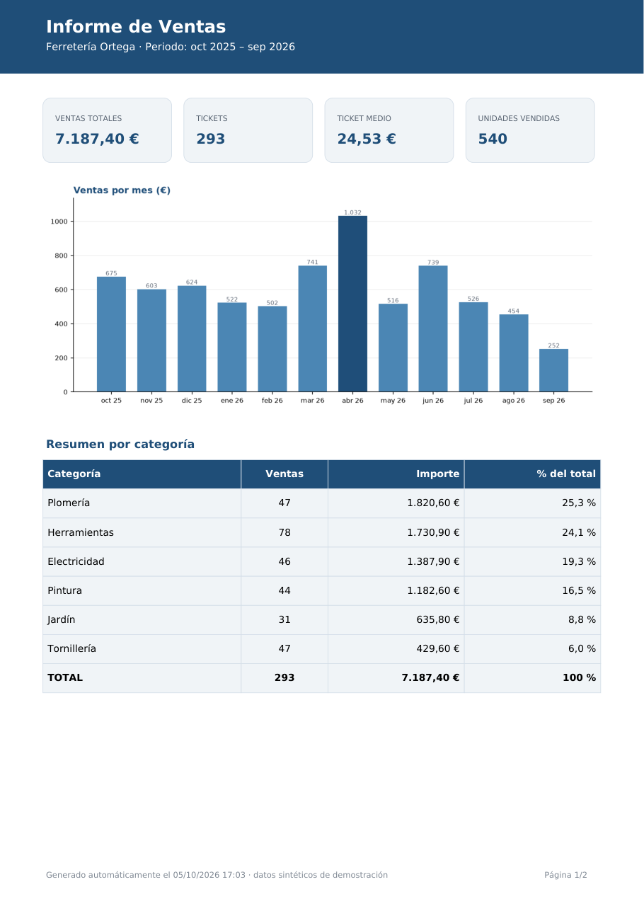
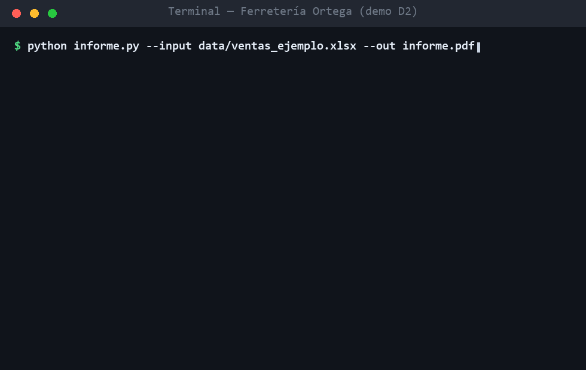

# Informe automático de ventas — Ferretería Ortega (demo D2)

> **⚠️ Negocio 100% FICTICIO.** "Ferretería Ortega" es una empresa inventada, creada
> como demostración de portafolio (*demo D2* de **Operación Freelancer**, servicio S2:
> *"elimino tu trabajo manual de pasar de Excel a informe"*). Todos los datos son
> **sintéticos y reproducibles** (semilla fija en [`generar_datos.py`](generar_datos.py)):
> ni la ferretería, ni sus ventas, ni sus cifras existen.



Un solo comando convierte un Excel de ventas en un **PDF profesional** (2 páginas A4):

```bash
python informe.py --input data/ventas_ejemplo.xlsx --out informe.pdf
```

Y lo que el cliente veía a mano cada mes — corregir erratas, sumar facturas, copiar
gráficos al Word — queda como un log de consola que se lee en 5 segundos:

```
2) Limpieza del archivo:
   · Filas leídas: 301
   · Fechas en texto convertidas a fecha: 3
   · Duplicados exactos eliminados: 4
   · Filas descartadas: 4 (1 cantidad nula, 1 fecha no válida, 1 importe no positivo, 1 importe nulo)
   · Categorías normalizadas: 3 (p. ej. "herramienta" → Herramientas)
6) Email:
   Modo demo: informe guardado; sin email (.env incompleto: faltan SMTP_HOST, …)
```

## En acción



## Qué hace esta demo

| Fase | Detalle |
| --- | --- |
| **Lee el Excel** | `data/ventas_ejemplo.xlsx`, pestaña "Ventas" (`fecha · producto · categoría · cantidad · importe`) — 301 filas de 12 meses, con la parte de "suciedad" típica de un Excel de cliente (duplicados, nulos, erratas, fechas en texto) |
| **Limpieza registrada** | Fechas en texto → fecha · duplicados exactos fuera · nulos e importes imposibles descartados **con motivo por consola** · categorías normalizadas a 6 válidas |
| **Métricas** | Ventas totales, nº tickets, ticket medio, unidades, top 5 productos, reparto por categoría y serie mensual |
| **PDF A4** (fpdf2) | Cabecera con periodo · 4 KPIs en cajas · gráfico de barras ventas/mes · top 5 productos · circular por categorías · tabla resumen con fila TOTAL · caja de **resumen automático** (conclusiones redactadas) · caja de **calidad de los datos** · pie con fecha de generación |
| **Email opcional (opt-in)** | Con `.env` completo (5 variables SMTP) envía el PDF como adjunto; sin `.env` → **modo demo: guarda y no envía nada** |

## El resultado, sin ejecutar nada

El [`informe.pdf`](informe.pdf) del repo es el ejemplo ya generado con los datos de muestra:
[página 1](docs/capturas/informe-pag1.png) · [página 2](docs/capturas/informe-pag2.png).

## Entregas "de serie" (la diferencia del servicio S2)

- **Cero pasos manuales**: de Excel sucio a PDF listo en un comando, con el detalle de
  qué se corrigió y qué se descartó impreso por consola (y dentro del PDF).
- **Números en formato español** (7.187,40 €) y tipografía incrustada (DejaVu, vía matplotlib) — el PDF se ve igual en cualquier equipo.
- **Dependencias con versión exacta** (`requirements.txt` sin `>=`/`~`) — la misma corrida reproduce el mismo informe.
- **Email opt-in por `.env`**: cero credenciales en el código; el modo demo no envía nada.
- **Test de la limpieza** (pytest) cubriendo fechas en texto, erratas de categoría, duplicados y descartes con motivo.
- **Datos 100% sintéticos y reproducibles**: `generar_datos.py --seed 42` regenera exactamente el Excel de ejemplo.

## Stack

- [Python 3.11+](https://www.python.org) · [pandas](https://pandas.pydata.org) (leer/limpiar/agregar) · [openpyxl](https://openpyxl.readthedocs.io) (Excel) · [matplotlib](https://matplotlib.org) (los 3 gráficos) · [fpdf2](https://py-pdf.github.io/fpdf2/) (el PDF A4) · [pytest](https://docs.pytest.org) (tests).
- Cero dependencias extra: el `.env` se parsea con stdlib y el email va con `smtplib` (stdlib).

## Cómo correrlo

```bash
python -m venv venv
venv/Scripts/pip install -r requirements.txt          # Linux/macOS: venv/bin/pip
venv/Scripts/python informe.py --input data/ventas_ejemplo.xlsx --out informe.pdf
venv/Scripts/python -m pytest                         # test de la limpieza (4 en verde)
```

Con tu propio Excel basta `--input tu_ventas.xlsx` (requisitos del formato y cómo
activar el email en **[DOC-USO.md](DOC-USO.md)**).

## Estructura

```
informe.py                  # todo el pipeline: leer → limpiar → métricas → gráficos → PDF → email
generar_datos.py            # genera el Excel sintético reproducible (seed fija)
data/ventas_ejemplo.xlsx    # el "Excel del cliente" (pestaña "Ventas", 301 filas)
informe.pdf                 # el ejemplo ya generado, commiteado para verlo sin ejecutar nada
tests/test_limpieza.py      # pytest de la limpieza
docs/capturas/              # páginas del PDF de ejemplo
.env.example                # plantilla del email opt-in (.env queda en local, ignorado)
```

## Estado

Demo terminada: pipeline verificado de punta a punta con los datos de ejemplo (PDF de 2
páginas + 4 tests en verde). El "Excel de entrada" es la única pieza que cambia entre
clientes. Alcance congelado según ficha — fuera de alcance: ejecución programada
(cron / Task Scheduler / GitHub Actions — **eso es la demo D3**), dashboards web,
base de datos, GUI o múltiples informes parametrizados.